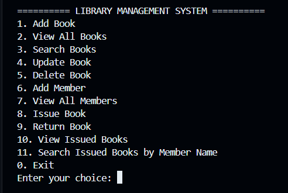
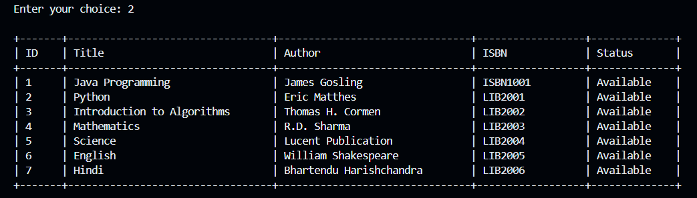
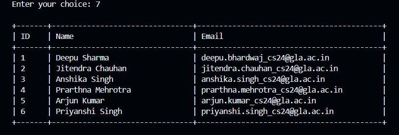
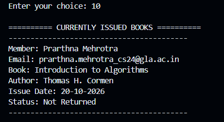

# LIBRARY MANAGEMENT SYSTEM
## Project Report

**Project Title:** Library Management System  
**Developed By:** Deepu Bhardwaj  
**Programming Language:** Java 21  
**Database:** SQLite  
**Database Connectivity:** JDBC  
**Build Tool:** Maven  

---

## 1. Introduction

The Library Management System is a Java-based console application developed to manage books, library members, and book issue and return records. It uses SQLite to store information persistently and JDBC to connect Java code with the database.

The application provides a menu-driven interface through which users can perform common library management operations.

## 2. Objectives

- To maintain book records efficiently.
- To register and manage library members.
- To issue available books to registered members.
- To record book returns and update availability.
- To search for books and currently issued books.
- To store data in a local database.

## 3. Technologies Used

| Technology | Purpose |
|---|---|
| Java 21 | Application development |
| JDBC | Database connectivity |
| SQLite | Persistent local storage |
| Maven | Dependency and build management |
| SQL | Database operations |

## 4. Main Features

1. Add new books.
2. View all books.
3. Search books by title, author, or ISBN.
4. Update book details.
5. Delete books when database constraints allow.
6. Register new library members.
7. View all members.
8. Issue available books.
9. Return issued books.
10. View currently issued books.
11. Search currently issued books by member name.

## 5. Database Design

The application uses three database tables.

### 5.1 Books Table

Stores the book ID, title, author, ISBN, and availability status.

### 5.2 Members Table

Stores the member ID, name, and email address.

### 5.3 Transactions Table

Stores the book ID, member ID, issue date, and return date. A null return date indicates that the book has not yet been returned.

The database uses unique constraints for ISBN and member email, along with foreign-key relationships between transactions, books, and members.

## 6. Project Structure

```text
Library-Management-System/
├── src/
│   └── main/
│       └── java/
│           └── deepu/
│               └── library/
│                   ├── Main.java
│                   ├── Book.java
│                   ├── Member.java
│                   ├── Database.java
│                   └── LibraryRepository.java
├── docs/
│   ├── 01-main-menu.png
│   ├── 02-all-books.png
│   ├── 03-all-members.png
│   ├── 04-issued-books.png
│   ├── Project-Report.md
│   └── Project-Report.pdf
├── pom.xml
├── .gitignore
└── README.md
```

## 7. How to Run the Project

Ensure that JDK 21 and Maven are installed.

### Compile the Application

```bash
mvn clean compile
```

### Run the Application

```bash
mvn exec:java
```

The application initializes the SQLite database named `library.db` in the project root.

## 8. Testing

The following operations have been tested during development:

- Adding and searching for books.
- Updating and deleting a book.
- Registering a library member.
- Issuing an available book.
- Viewing issued-book records.
- Searching issued books by member name.
- Returning a book and checking its availability.
- Running the application after updating database connection handling.

## 9. Application Screenshots

### 9.1 Main Menu



### 9.2 View All Books



### 9.3 View All Members



### 9.4 Currently Issued Books



## 10. Learning Outcomes

This project provides practical experience with Java object-oriented programming, JDBC, SQL queries, SQLite database design, prepared statements, exception handling, and transaction management.

## 11. Conclusion

The Library Management System demonstrates how Java and SQLite can be combined to develop a basic database-driven application. It provides essential book and member management features and maintains issue and return records for library operations.

---

**Author:** Deepu Bhardwaj
